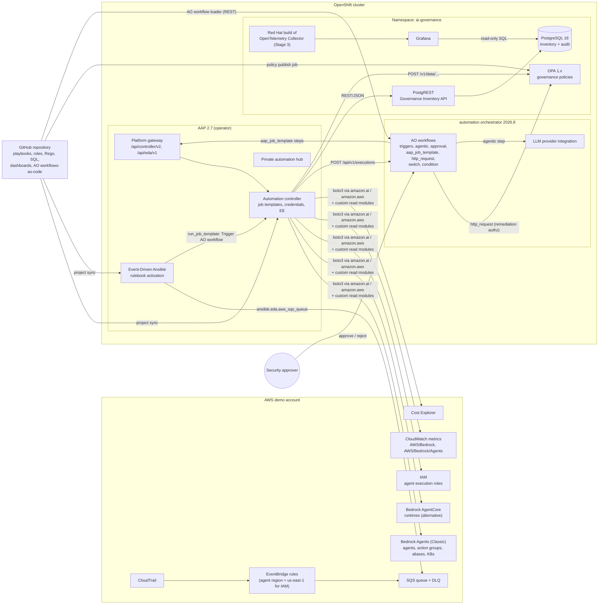
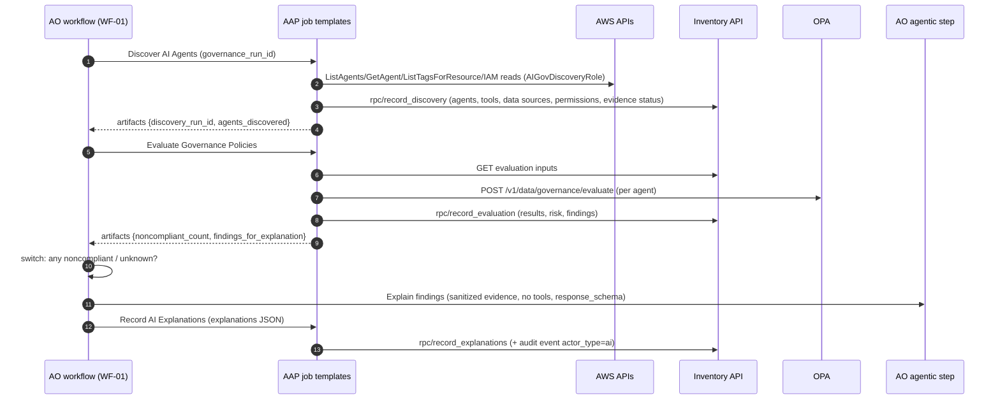

# 02 — Solution Architecture

This document defines the component architecture, integration points, deployment topology, authentication model, security boundaries, and data flows for all three stages.

Verification legend used throughout the plan:

- ✅ **Verified** — read directly in official documentation or source code at the stated version
- 🟡 **Partially verified** — seen in search snippets of official docs, or proven in the existing `ao_demo_config` / `sales.demos` reference repositories against a live AO, but not read in full official docs
- ❓ **Unverified** — must be validated during the Stage 0 spike before dependent work starts

---

## 1. Architectural principles

1. **Policy decides, AI advises.** Every authorization decision (is it a violation, is remediation allowed, does it need approval, is it resolved) is made by deterministic Rego policy or a named human. AI output is never used directly in a branch condition.
2. **Detection-only by default.** Remediation is disabled in policy data until explicitly enabled through a reviewed Git change, and every remediation job defaults to dry-run.
3. **Verify before close.** A finding is resolved only after re-collection, simulation, and OPA re-evaluation pass.
4. **Audit by construction.** Every playbook writes its own audit events to an append-only, hash-chained table; nothing relies on a single "write audit at the end" step.
5. **Certified content first.** Every *write* to AWS uses a certified module where one exists (`amazon.aws`, `amazon.ai`). Small custom modules are written only for documented API gaps, and are read-only wherever possible.
6. **Open interfaces.** REST and JSON between all components; Rego for policy; SQL for inventory; JSON Schema for contracts; OpenTelemetry for telemetry.
7. **Provider-neutral core.** Cloud-specific logic lives only in discovery adapters and remediation action implementations. The inventory schema, OPA contracts, workflows, and dashboards are provider-neutral.
8. **Config as code.** AAP, EDA, AO, OPA, Grafana, database schema, and governance registry data are all defined in the repository and applied by automation.
9. **POC pragmatism.** One OpenShift cluster, one AWS demo account (multi-account is designed but deferred), no custom web UI.

## 2. Component architecture



### 2.1 Component responsibilities

| Component | Responsibility | Technology / version | Status |
|---|---|---|---|
| **automation orchestrator (AO)** | Orchestrates governance workflows: triggers, AI explanation, OPA authorization call, approvals, AAP job steps, branching | AO 2026.8, operator on OpenShift, add-on to AAP 2.7+ | 🟡 node types proven in reference exports; ❓ import/export format |
| **Automation controller** | Executes all discovery, evaluation, persistence, remediation, verification, rollback, notification, and reporting playbooks | AAP 2.7 (controller 4.8.x; the connected environment reports 4.8.13) | ✅ |
| **Event-Driven Ansible (EDA)** | Consumes AWS change events from SQS, filters and throttles them, launches the "Trigger AO workflow" job template | `ansible.eda` 2.13.0, `aws_sqs_queue` source | ✅ source exists; 🟡 pattern proven in `ao_demo_config` |
| **Private automation hub** | Serves certified, validated, and the project collection; hosts the execution environment image | AAP 2.7 hub | ✅ |
| **OPA** | Evaluates governance policies, risk score, and remediation authorization; returns structured JSON | OPA 1.22.x (Rego v1) | ✅ |
| **PostgreSQL** | System of record: inventory, snapshots, evaluations, findings, remediations, approvals, audit | PostgreSQL 16 (`registry.redhat.io/rhel9/postgresql-16`) | ✅ image exists; ❓ customer standard |
| **PostgREST** | Thin REST/JSON API over PostgreSQL with role-based grants and transactional RPC functions | PostgREST 12.x/13.x (open source, MIT) | ✅ project; **decision required** (see §6) |
| **Grafana** | Governance dashboards, provisioned from JSON in Git | Grafana OSS 13.x | ✅ |
| **OpenTelemetry Collector** | Stage 3: receives OTLP from governance jobs and instrumented agents; optionally scrapes CloudWatch metrics | Red Hat build of OpenTelemetry (OpenShift) | 🟡 receiver availability must be validated |
| **LLM provider** | Powers the AO `agentic` step | **Decided:** the existing AO credential "LiteMaaS API Key", model `llama-scout-17b` (Red Hat MaaS, already used by "Compliance as Code - Golden Image (as code)") | ✅ in use in the target AO; structured-output reliability tested in T0.02 (Q-27) |
| **GitHub** | Source of truth for all content | github.com/mlowcher61/ai-governance-control-tower | ✅ |

## 3. Integration points

| # | From → To | Interface | Auth | Notes |
|---|---|---|---|---|
| I-1 | Controller jobs → AWS | boto3 via `amazon.ai`, `amazon.aws`, project modules | AAP "Amazon Web Services" credential (bootstrap principal) → `sts:AssumeRole` into **AIGovDiscoveryRole** or **AIGovRemediationRole** with external ID | Separate AAP credentials per role so discovery templates can never remediate |
| I-2 | Controller jobs → Governance Inventory API | `ansible.builtin.uri`, JSON | JWT bearer from custom credential type "AI Governance - Inventory API" | JWT role claim maps to a PostgreSQL role with least-privilege grants |
| I-3 | Controller jobs → OPA | `POST /v1/data/governance/evaluate` | Network policy; optional bearer token (OPA `--authentication=token`) | Undefined result returns `200` with no `result` key — must be treated as an error |
| I-4 | AO → controller | `aap_job_template` node | AO credential type "Ansible Automation Platform" + AAP integration | `set_stats` data returned as `${node_id.artifacts.*}` 🟡 |
| I-5 | AO → OPA | `http_request` node, POST JSON | None inside cluster (network policy) | Proven pattern in `sales.demos` (`ao_workflows_aac.yml`) 🟡; AO SSRF allowlist must include the OPA host |
| I-6 | AO → LLM | `agentic` node via LLM provider integration | AO "LLM Provider" credential | `responseSchema` constrains output ✅ (OpenAPI 1.3.0) |
| I-7 | Controller job → AO | `POST /api/v1/auth/token` (client credentials) then `POST /api/v1/executions` | AO service account client ID/secret in custom credential type "AI Governance - Automation Orchestrator" | Proven in `ao_demo_config/event-driven-xsos-rca` 🟡 |
| I-8 | AWS → EDA | EventBridge rule → SQS; EDA `ansible.eda.aws_sqs_queue` polls | IAM user/role with `sqs:ReceiveMessage`, `sqs:DeleteMessage` only | Pull model: no inbound internet exposure of EDA |
| I-9 | EDA → controller | `run_job_template` action | EDA "Red Hat Ansible Automation Platform" credential | |
| I-10 | Grafana → PostgreSQL | Grafana PostgreSQL data source | `grafana_ro` role (SELECT on reporting views only) | Grafana does not validate query safety; read-only role is mandatory |
| I-11 | Controller job → AO API (audit capture) | `GET /api/v1/executions/{id}`, `/executions/{id}/activities`, `/approvals?execution_id=` | Same AO service account | Captures approver identity and decision notes into the audit trail |
| I-12 | Controller job → notification targets | Webhook (Slack/Teams/generic), optionally `servicenow.itsm` | Custom credential type "AI Governance - Notification" | |
| I-13 | Policy publish job → OPA | Kubernetes ConfigMap update (`kubernetes.core.k8s`), OPA `--watch` | OpenShift service account token in AAP "OpenShift or Kubernetes API Bearer Token" credential | Bundle revision (Git SHA) embedded in policy data and recorded with every decision |

## 4. Deployment topology

### 4.1 POC topology (recommended)

A single OpenShift cluster hosts AAP, AO, and the governance services. AO only runs on OpenShift (🟡 AO docs: operator install; integrated, standalone, and disconnected models), so co-locating everything on OpenShift minimizes moving parts.

| Namespace | Workloads | Deployed by |
|---|---|---|
| `aap` (existing) | AAP 2.7 operator: gateway, controller, EDA, hub | Customer / existing |
| `automation-orchestrator` (existing or new) | AO backend, worker, frontend; AO PostgreSQL databases | Customer / existing |
| `ai-governance` | `governance-db` (StatefulSet, PVC), `governance-api` (PostgREST Deployment), `opa` (Deployment, 2 replicas), `grafana` (Deployment, PVC optional), `otel-collector` (Stage 3) | Job template **AI Governance - Deploy Platform Services** using `kubernetes.core.k8s` (certified) |

Routes are created only for Grafana and, optionally, the Inventory API (for demo inspection). OPA and PostgreSQL are cluster-internal only.

### 4.2 Network boundaries (NetworkPolicy)

| Destination | Allowed sources |
|---|---|
| `governance-db:5432` | `governance-api`, `grafana`, migration Job |
| `governance-api:3000` | AAP execution pods (controller job namespace), AO worker (read-only endpoints), Route (optional, demo only) |
| `opa:8181` | AAP execution pods, AO worker |
| `grafana:3000` | OpenShift Route (SSO via OpenShift OAuth proxy or Grafana OIDC — see open questions) |

AO blocks private-network URLs by default for REST steps and integrations (🟡). The AO admin setting `APP_INTEGRATION_URL_ALLOWED_HOSTS` must include the OPA and Inventory API service hosts, and the setting must reach the **ao-worker** pods as well as ao-backend (observed in `sales.demos/playbooks/configure_ao.yml`).

### 4.3 Enterprise topology (Stage 3 target)

See [05-stage-three-plan.md §10](05-stage-three-plan.md#10-enterprise-deployment-architecture). In short: OPA and the Inventory API scale horizontally; PostgreSQL moves to a managed or HA service; AWS discovery fans out across accounts through an Organizations-delegated discovery role; additional provider adapters plug into the same contracts.

## 5. Authentication and identity

| Identity | Type | Used by | Permissions (summary) |
|---|---|---|---|
| `aigov-bootstrap` | AWS IAM user or IAM Roles Anywhere / OIDC principal | AAP AWS credential | `sts:AssumeRole` on the two governance roles only |
| `AIGovDiscoveryRole` | IAM role (external ID) | Discovery, evaluation, verification jobs | Read-only: `bedrock:List*/Get*` (agents, aliases, action groups, KBs, data sources, tags), `bedrock-agentcore:List*/Get*`, `iam:Get*/List*`, `iam:SimulatePrincipalPolicy`, `cloudtrail:LookupEvents`, `cloudwatch:GetMetricData`, `ce:GetCostAndUsage` (Stage 3) |
| `AIGovRemediationRole` | IAM role (external ID) | Remediation and rollback jobs only | Scoped writes: `iam:AttachRolePolicy`, `iam:DetachRolePolicy`, `iam:PutRolePermissionsBoundary`, `iam:DeleteRolePermissionsBoundary`, `iam:DeleteRolePolicy`, `iam:PutRolePolicy`, `iam:TagRole` **only on roles tagged `aigov:managed=true` / matching the demo path**; `bedrock:UpdateAgentActionGroup`, `bedrock:PrepareAgent`, `bedrock:UpdateAgentAlias`, `bedrock:TagResource`, `bedrock:UntagResource` on agents in the allowlisted account; `iam:PassRole` denied. No `Delete*` on agents. |
| AO service account `aigov-trigger` | AO OAuth2 client credentials | "Trigger AO workflow" job, audit-capture job | Run the governance workflows; read executions and approvals |
| AO AAP credential | AO credential of type "Ansible Automation Platform" | `aap_job_template` steps | AAP user `svc-aigov-ao` with **Execute** on governance job templates only |
| PostgreSQL roles | `aigov_owner`, `aigov_api_anon` (no access), `aigov_discovery`, `aigov_evaluator`, `aigov_remediator`, `aigov_reader`, `grafana_ro`, `aigov_auditor` | PostgREST JWT role switching / Grafana | Each role can call only the RPC functions it needs; `audit_events` is INSERT-only for writers and SELECT-only for readers |
| Human approvers | AAP-federated users in AO | AO approval steps | Named in workflow `approver_users` |

Secrets are stored in AAP credentials (custom credential types with injectors), optionally sourced from an external secret backend (HashiCorp Vault, AWS Secrets Manager lookup, CyberArk — 🟡 AAP 2.7 docs). **No secrets are stored in Git**, and no Ansible Vault files are used.

## 6. Key design decisions (with rationale)

| ID | Decision | Rationale | Alternatives considered |
|---|---|---|---|
| AD-01 | **AAP job templates perform all cloud reads and writes; AO orchestrates** | Reuses AAP credentials, RBAC, EE, job logs; AO's `aap_job_template` step is the proven integration | AO REST steps calling AWS directly (no SigV4 support documented; secrets in workflow) |
| AD-02 | **AO calls OPA directly via `http_request` only for remediation authorization** | Makes the deterministic decision visible in the AO canvas and drives `switch` nodes from policy, not AI; proven pattern in `sales.demos` | Evaluate OPA only inside AAP jobs (hides the decision from the AO story) |
| AD-03 | **PostgREST in front of PostgreSQL** | No certified PostgreSQL module collection exists (✅ hub inspection); REST/JSON is callable from `ansible.builtin.uri` and AO; JWT roles give least privilege; transactional RPC functions keep write logic in SQL; zero custom API code | `community.postgresql` (Galaxy community content); custom FastAPI service (more code to own) |
| AD-04 | **Jobs never fail on business outcomes** — remediation and verification playbooks use `block`/`rescue` and always report `status` via `set_stats`; AO branches with `condition` nodes on that status | Failure-port semantics for `aap_job_template` nodes are not documented ❓; explicit status keeps every branch (failed, verification failed) deterministic and auditable | Rely on AO job-failure behavior |
| AD-05 | **Remediation enablement lives in OPA policy data in Git** (`remediation.enabled: false` by default) | Enabling remediation requires a reviewed pull request and a policy publish job: auditable and reversible | Toggle in database or survey (too easy to flip silently) |
| AD-06 | **Governance registry as code** (owners, registrations, risk assessments in YAML, loaded into PostgreSQL) | Owner, purpose, and risk-assessment data cannot be discovered; Git gives review and history; simple for a POC | ServiceNow CMDB / GRC integration (Stage 3+ enhancement) |
| AD-07 | **Correlation ID** `governance_run_id` (UUID) generated at the start of every workflow and passed to every job and audit event | Joins AO executions, AAP jobs, OPA decision IDs, and DB records | |
| AD-08 | **Workflows as code** using the "by name" YAML format proven in `sales.demos`, rendered to AO `schema_version 2.0.0` JSON and validated via `POST /api/v1/workflows/validate` | Raw exports contain environment-specific UUIDs, job template IDs, and federated usernames | Commit raw exports only (not portable) |
| AD-09 | **SQS rather than EventBridge API destinations** for event delivery to EDA | Pull model needs no inbound exposure, has DLQ, tolerates EDA restarts; API destinations have a 5-second timeout and require a public HTTPS endpoint (✅ AWS docs) | API destination → EDA event stream (acceptable alternative where EDA is internet-reachable) |
| AD-10 | **OPA deployed with plain manifests via `kubernetes.core`** | The certified `styra.opa` 1.1.1 collection contains only a Kubernetes installer role last updated in April 2024 (✅ GitHub) and predates OPA 1.x; plain manifests are simpler to pin | `styra.opa.k8s_pdp` role (evaluate in Stage 0 spike; adopt if it supports current OPA images cleanly) |

## 7. Data flows

### 7.1 Stage 1 — discovery and assessment



### 7.2 Stage 2 — closed-loop remediation

Summary (full node-by-node specification in [04-stage-two-plan.md](04-stage-two-plan.md)):

```
Event/finding → Get context → Re-evaluate (fresh) → [compliant | noncompliant | missing evidence | error]
  noncompliant → OPA remediation authz (http_request) → [detect-only | auto-permitted | approval-required | denied]
  → AI explain & recommend (advisory, from allowed actions only) → Plan remediation (dry-run, validate AI choice, snapshot pre-state)
  → approval (if required) → [rejected → record & notify] | [approved]
  → Remediate (status in artifacts) → [failed → rollback/escalate] | [succeeded]
  → Verify (re-discover, simulate, OPA re-eval) → [verification failed → rollback/escalate] | [verified]
  → Close finding → Finalize audit (capture AO execution + approval) → Notify
```

### 7.3 Stage 3 — continuous governance

```
CloudTrail management event (bedrock / bedrock-agentcore / iam)
  → EventBridge rule (agent Region; IAM rule in us-east-1)
  → SQS (DLQ after N receives)
  → EDA rulebook: filter relevant eventNames, drop events whose userIdentity is AIGovRemediationRole, throttle per agent
  → Job template "Trigger AO workflow" → AO WF-03 "Targeted Re-assessment"
  → targeted discovery + evaluation for the affected agent → if new/worsened finding and policy permits → WF-02 remediation
Scheduled reconciliation (AO schedule trigger, nightly + hourly light scan) → full discovery → drift and deletion detection
```

## 8. Security boundaries (summary)

Detailed threat model in [08-security-and-governance.md](08-security-and-governance.md).

| Boundary | Control |
|---|---|
| AWS account ↔ AAP | Assume-role with external ID; separate read and write roles; remediation role scoped by tag/path and to an allowlisted account |
| AO ↔ AAP | AO uses a dedicated AAP user with Execute only on governance templates |
| AI ↔ decisions | AI step has `tool_selection_strategy: NONE`; output schema restricted to enumerated action IDs; deterministic validation in the plan job; switches never read AI output |
| Policy authority | OPA bundle from protected Git branch; bundle revision recorded on every decision; remediation disabled by default |
| Inventory integrity | Append-only audit table with hash chain; UPDATE/DELETE blocked by trigger and grants |
| Human approval | Named approvers; `fallback_decision: reject`; approval identity captured from the AO API |

## 9. Reference sources

| Topic | Source |
|---|---|
| AO product docs (2026.8) | https://docs.redhat.com/en/documentation/automation_orchestrator/2026.8 |
| AO announcement / GA | https://www.redhat.com/en/blog/unify-it-workflows-scale-new-automation-orchestrator-ansible-automation-platform |
| AO REST API step | https://docs.redhat.com/pt-br/documentation/automation_orchestrator/2026.8/develop-add_a_rest_api_step_to_a_workflow |
| AO reference exports (local) | `/Users/mlowcher/Documents/cac/ao_demo_config/*/ao/*.json`, `/Users/mlowcher/Documents/cac/sales.demos/inventory/group_vars/aap/ao_workflows*.yml` |
| AAP 2.7 docs | https://docs.redhat.com/en/documentation/red_hat_ansible_automation_platform/2.7 |
| AAP 2.7 API changes (gateway-only access) | https://docs.redhat.com/en/documentation/red_hat_ansible_automation_platform/2.7/upgrade-con_upgrade_api_changes_27 |
| AAP custom credential types | https://docs.redhat.com/en/documentation/red_hat_ansible_automation_platform/2.7/secure-assembly_controller_custom_credentials |
| AAP secret management | https://docs.redhat.com/en/documentation/red_hat_ansible_automation_platform/2.7/secure-assembly_controller_secret_management |
| Bedrock Agents Classic maintenance mode | https://docs.aws.amazon.com/bedrock/latest/userguide/agents-classic-maintenance-mode.html |
| OPA REST API | https://www.openpolicyagent.org/docs/rest-api |
| PostgREST | https://docs.postgrest.org/ |
| Grafana provisioning | https://grafana.com/docs/grafana/latest/administration/provisioning/ |
