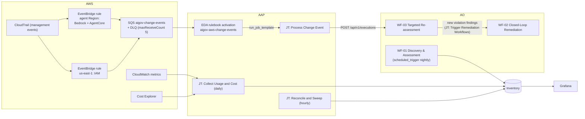
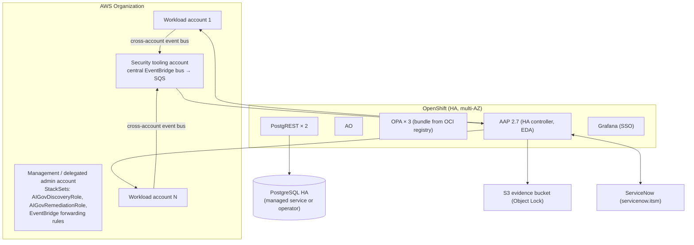

# 05 — Stage Three Plan: Continuous AI Governance and Compliance

**Objective:** Turn the Stage 1 and Stage 2 capabilities into a continuously operating service. It combines event-driven detection, scheduled reconciliation, compliance history, reporting, cost and value measurement, and operational dashboards.

---

## 1. Stage Three deliverables map

| # | Deliverable | Section |
|---|---|---|
| 1 | Event-driven architecture | §2 |
| 2 | EDA rulebook design | §3 |
| 3 | Monitoring integration specifications | §4 |
| 4 | OpenTelemetry instrumentation plan | §5 |
| 5 | Grafana dashboard specifications | §6 |
| 6 | Compliance evidence architecture | §7 |
| 7 | Reporting specifications | §8 |
| 8 | Cost and ROI measurement methodology | §9 |
| 9 | Operational runbooks | §10 |
| 10 | Enterprise deployment architecture | §11 |

## 2. Event-driven architecture

### 2.1 Two different kinds of monitoring

| | **Configuration-change detection** (control plane) | **Runtime AI activity monitoring** (data plane) |
|---|---|---|
| Question answered | "Did someone create, change, or grant something that affects governance?" | "What are agents actually doing: invocations, tokens, tools called, errors?" |
| AWS sources | CloudTrail **management events** for Bedrock, AgentCore, and IAM (on by default ✅) → EventBridge | CloudWatch `AWS/Bedrock/Agents` and `AWS/Bedrock` metrics ✅; model invocation logging (off by default ✅); CloudTrail **data events** for `InvokeAgent` (opt-in, extra cost ✅); OTel GenAI traces from instrumented agents |
| Latency | Seconds to minutes (EventBridge → SQS → EDA) | Minutes (metrics), batch (cost: up to 24 h) |
| Governance use | Trigger targeted re-assessment and remediation | Usage, cost, anomaly context, "is this agent actually used?", dormant-agent detection |
| Enforcement? | Yes, it can trigger WF-02 | No, informational in this POC. Runtime authorization (blocking a tool call in flight) needs a gateway such as AgentCore Gateway Policy and is out of scope ([10-competitive-analysis.md](10-competitive-analysis.md)) |

### 2.2 Architecture



### 2.3 Event flow detail

1. **CloudTrail** records a management event, for example `AttachRolePolicy` on `quick_helper_bot-role`.
2. **EventBridge** matches it. IAM is a global service, and its CloudTrail events are delivered **only to the us-east-1 default bus**, so the IAM rule must live in us-east-1 (🟡 AWS re:Post / EventBridge docs). The Bedrock and AgentCore rules live in each agent Region. Both rules target one SQS queue, in us-east-1 for the POC.
3. **SQS** buffers events. A DLQ captures poison messages, and messages wait if EDA is down.
4. **The EDA rulebook** (§3) drops self-generated events, keeps only relevant `eventName`s, throttles per resource, and launches **AI Governance - Process Change Event**.
5. **Process Change Event** (deterministic):
   - stores the event (`change_events` table, audit `event.received`);
   - maps it to inventory agents, by agent ID for Bedrock events or by role ARN to the agents using that role for IAM events;
   - ignores events for roles not linked to any agent (audit `event.ignored`, reason `not_agent_related`);
   - otherwise calls AO `POST /api/v1/executions` for WF-03 with `{agent_ids, change_event_id}`.
6. **WF-03 Targeted Re-assessment** runs targeted discovery and evaluation for the affected agents. It records `source_change_at = eventTime` on new findings, which feeds MTTD. For each **new or worsened violation**, it launches WF-02 through the JT **AI Governance - Trigger Remediation Workflows**. WF-02 itself decides detect-only, denied, approval, or auto through OPA.

### 2.4 WF-03 node specification

| Node ID | Type | Purpose |
|---|---|---|
| `trigger_manual` | `manual_trigger` (`input_schema`: `agent_ids` string, comma-separated; `change_event_id`) | Started by Process Change Event or manually |
| `activity_reassess` | `aap_job_template` — **AI Governance - Reassess Agent** (multi-agent mode) | Targeted discovery and evaluation; artifacts `new_violation_finding_ids` (CSV), `new_violation_count` |
| `logic_new_violations` | `condition` `${activity_reassess.artifacts.new_violation_count} > 0` | |
| `activity_trigger_remediation` | `aap_job_template` — **AI Governance - Trigger Remediation Workflows** | Starts one WF-02 execution per finding through the AO API, skipping findings with an active remediation |
| `activity_finalize` | `aap_job_template` — **AI Governance - Finalize Audit and Notify** | |

**As built (T3.03):** WF-03 is `ao_workflows/definitions/wf03_targeted_reassessment.yml`: **Assess Agents** (a new job, not Reassess
Agent in a multi-agent mode) → condition on `new_violation_count` → **Trigger Remediation Workflows**. Assess Agents re-collects
only the affected agents live with the discovery role and records `assessment` evaluations; it does not rewrite the inventory, so
agents that were not assessed are never marked missing. `api.complete_targeted_assessment` (V014) computes the new and worsened
violations in the database and stamps new findings with the change's event time. Trigger Remediation Workflows skips findings that
are not open, have an active remediation or are in cooldown. No finalize node: the change event, the run and each WF-02 outcome are
audited, and each WF-02 run finalizes itself.

### 2.5 EventBridge rule patterns (CloudFormation, `aws/cloudformation/aigov-events.yaml`)

```json
{
  "source": ["aws.bedrock", "aws.bedrock-agentcore"],
  "detail-type": ["AWS API Call via CloudTrail"],
  "detail": {
    "eventSource": ["bedrock.amazonaws.com", "bedrock-agentcore.amazonaws.com"],
    "eventName": ["CreateAgent", "UpdateAgent", "DeleteAgent", "PrepareAgent",
                  "CreateAgentActionGroup", "UpdateAgentActionGroup", "DeleteAgentActionGroup",
                  "AssociateAgentKnowledgeBase", "UpdateAgentKnowledgeBase", "DisassociateAgentKnowledgeBase",
                  "CreateAgentAlias", "UpdateAgentAlias", "DeleteAgentAlias",
                  "AssociateAgentCollaborator", "DisassociateAgentCollaborator",
                  "TagResource", "UntagResource",
                  "CreateAgentRuntime", "UpdateAgentRuntime", "DeleteAgentRuntime"]
  }
}
```

```json
{
  "source": ["aws.iam"],
  "detail-type": ["AWS API Call via CloudTrail"],
  "detail": {
    "eventSource": ["iam.amazonaws.com"],
    "eventName": ["AttachRolePolicy", "DetachRolePolicy", "PutRolePolicy", "DeleteRolePolicy",
                  "PutRolePermissionsBoundary", "DeleteRolePermissionsBoundary",
                  "UpdateAssumeRolePolicy", "CreatePolicyVersion", "SetDefaultPolicyVersion"]
  }
}
```

The `source` and `eventSource` values for Bedrock Agents and AgentCore are ❓. Search results indicate `bedrock.amazonaws.com` and `bedrock-agentcore.amazonaws.com`, but agent-specific values were not confirmed in official docs. **T3.01 captures real events in the demo account and freezes the patterns.** The stack is deployed by **AI Governance - Deploy AWS Event Plumbing** using `amazon.aws.cloudformation` (✅ certified module).

### 2.6 Scheduled reconciliation

Event delivery is not guaranteed to be complete: trails can be misconfigured, and Regions or accounts can be added. Scheduled reconciliation is therefore the **source of completeness**, and events are the **source of speed**.

| Schedule | Mechanism | Work |
|---|---|---|
| Nightly 02:00 | AO `scheduled_trigger` on WF-01 (✅ OpenAPI node type); an AAP schedule on the Discover JT is the fallback | Full discovery and evaluation in all scopes; drift detection; daily compliance snapshot |
| Hourly | AAP schedule: **AI Governance - Reconcile and Sweep** | Expire stale `awaiting_approval` or `planned` remediations (`expired`); flag agents with `missing_since > 24 h` as `agent.missing`; check the SQS DLQ depth; verify the audit hash chain incrementally |
| Daily 06:00 | AAP schedule: **AI Governance - Collect Usage and Cost** | CloudWatch metrics and Cost Explorer into `usage_metrics` |
| Weekly | AAP schedule: **AI Governance - Generate Compliance Report** | Posture and control evidence reports |

**Drift detection.** When a snapshot's `content_hash` differs from the previous snapshot, the database function `api.snapshot_diff(agent_id, from, to)` computes a JSON diff over normalized fields. The function writes `agent.config_drift` audit events with the changed paths. If the change was not preceded by a matching change event, it is labelled **unattributed drift**, which signals a coverage gap in event plumbing.

## 3. EDA rulebook design

`eda/rulebooks/aigov_aws_change_events.yml`:

```yaml
---
- name: AI governance - AWS change events
  hosts: all
  sources:
    - name: aigov_sqs
      ansible.eda.aws_sqs_queue:
        queue_url: "{{ aigov_sqs_queue_url }}"
        region: "{{ aigov_sqs_region }}"
        delay_seconds: 2
  rules:
    # Rules are evaluated in order; first match wins (match_multiple_rules defaults to false)
    - name: Suppress changes made by governance remediation (loop prevention)
      condition: event.body.detail.userIdentity.arn is search("assumed-role/AIGovRemediationRole/", ignorecase=true)
      action:
        debug:
          msg: "Suppressed self-generated event {{ event.body.detail.eventName }} {{ event.body.detail.eventID }}"

    - name: Bedrock or AgentCore agent configuration changed
      condition: >-
        event.body.detail.eventSource in ["bedrock.amazonaws.com", "bedrock-agentcore.amazonaws.com"]
        and event.body.detail.errorCode is not defined
      throttle:
        once_within: 2 minutes
        group_by_attributes:
          - event.body.detail.requestParameters.agentId
      action:
        run_job_template:
          name: AI Governance - Process Change Event
          organization: AI Governance
          job_args:
            extra_vars:
              aigov_change_event: "{{ event.body }}"

    - name: IAM role permission changed
      condition: >-
        event.body.detail.eventSource == "iam.amazonaws.com"
        and event.body.detail.errorCode is not defined
      throttle:
        once_within: 2 minutes
        group_by_attributes:
          - event.body.detail.requestParameters.roleName
      action:
        run_job_template:
          name: AI Governance - Process Change Event
          organization: AI Governance
          job_args:
            extra_vars:
              aigov_change_event: "{{ event.body }}"
```

**As built (T3.02, AAP 2.7):** `extensions/eda/rulebooks/aigov_aws_change_events.yml` differs from the sketch above in three ways,
each found on the live decision environment:
- the source is the certified `amazon.aws.aws_sqs_queue` (the `ansible.eda` one is deprecated) and takes the queue **name**, not its URL;
  it delivers `{"body": <parsed message body>, "meta": ...}`, so `event.body` is right;
- conditions use `==` joined with `or`: a list membership test (`in [...]`) never matched, so real AgentCore events were consumed
  without any rule firing;
- agent changes have one rule per event shape (`resourceArn`, `agentRuntimeId`, `agentId`, then an unthrottled fallback), so each
  throttle groups by an attribute its events always carry. Both governance roles (remediation and demo reset) are dropped.

**Design notes:**

- **SQS rather than a webhook** (AD-09). EDA polls with credentials scoped to `sqs:ReceiveMessage`, `sqs:DeleteMessage`, and `sqs:GetQueueAttributes` on one queue, injected through an EDA credential.
- **Throttle choice.** `throttle.once_within` with `group_by_attributes` keeps the first event of a burst. Process Change Event re-reads the current state anyway, so losing intermediate events in a burst is safe.
- **To be verified in T3.02:** the event structure from `aws_sqs_queue`, and whether `event.body` is the parsed JSON body (🟡, it was used by `ao_demo_config/extensions/eda/rulebooks/event-driven-xsos-rca.yml`); throttle semantics against `ansible-rulebook` in the AAP 2.7 decision environment.
- **EDA config as code.** The project, decision environment (`de-supported-rhel9`, AAP 2.7), credentials, and rulebook activation are defined with `infra.aap_configuration` `eda_*` roles (✅ the role group exists).
- **Why EDA calls a job template rather than AO directly.** EDA's `run_module` with `ansible.builtin.uri` cannot perform AO's OAuth2 client-credentials flow cleanly (observed note in `ao_demo_config`). The job template also adds deterministic event-to-agent mapping and audit.

## 4. Monitoring integration specifications

| Integration | Data | API / mechanism | Implementation | Stage 3 priority |
|---|---|---|---|---|
| CloudTrail → EventBridge → SQS | Control-plane changes | §2.5 | CloudFormation + EDA | P0 |
| CloudWatch `AWS/Bedrock/Agents` | `InvocationCount`, `TotalTime`, `TTFT`, `ModelInvocationCount`, `InputTokenCount`, `OutputTokenCount`, errors and throttles; dimensions `Operation`, `ModelId`, `AgentAliasArn` (✅ [doc](https://docs.aws.amazon.com/bedrock/latest/userguide/monitoring-agents-cw-metrics.html)) | `cloudwatch:GetMetricData` | Custom read-only module `cloudwatch_metric_data_info` (no `amazon.aws` module returns metric data); daily job writes `usage_metrics` | P0 |
| CloudWatch `AWS/Bedrock` | `Invocations`, `InputTokenCount`, `OutputTokenCount` by `ModelId` (✅) | same | same | P1 |
| Model invocation logging | Per-request identity ARN and token counts (off by default ✅) | CloudWatch Logs / S3 | Discovery records whether it is enabled (`GetModelInvocationLoggingConfiguration`) as a posture signal; content is **not** ingested in the POC | P1 (posture only) |
| Cost Explorer | Actual Bedrock cost, optionally by cost allocation tag via application inference profiles (🟡 [doc](https://docs.aws.amazon.com/bedrock/latest/userguide/cost-management.html)) | `ce:GetCostAndUsage` | Custom read-only module `cost_explorer_info`; daily | P1 |
| AgentCore observability | Runtime traces and metrics | CloudWatch / OTel | Deferred, documented | P2 |
| Azure Activity Log | Control-plane changes for Foundry agents | Activity Log → Event Grid → Service Bus queue → `ansible.eda.azure_service_bus` (✅ the EDA source exists) | Designed only | P2 |
| Google Cloud Audit Logs | Admin Activity logs for Vertex AI Agent Engine | Log sink → Pub/Sub push subscription → EDA event stream (webhook) | Designed only; there is no Pub/Sub EDA source in `ansible.eda` 2.13.0 | P2 |

## 5. OpenTelemetry instrumentation plan

| Signal | Producer | Transport | Backend | Use |
|---|---|---|---|---|
| **Governance pipeline traces** | Each AAP governance job emits one span (start, end, status, `aigov.governance_run_id`, `aigov.job_template`, `aigov.agent_id`). The trace ID is derived deterministically from `governance_run_id` | OTLP/HTTP JSON `POST /v1/traces` from a small role `mlowcher61.ai_governance.otel_emit` (`ansible.builtin.uri`). Evaluating `community.general.opentelemetry` callback is a P2 alternative; it is community content | Red Hat build of OpenTelemetry Collector → Tempo (or Grafana Tempo data source) | End-to-end latency per stage; MTTR decomposition; pipeline troubleshooting |
| **Governance metrics** | Derived from PostgreSQL views (primary); optionally exported as OTel metrics | Grafana SQL; optional Collector `sqlquery` receiver ❓ | Grafana | Dashboards (§6) |
| **AI runtime traces** (agent owners' responsibility) | Agents instrumented with the OTel GenAI semantic conventions: `gen_ai.operation.name=invoke_agent`, `gen_ai.provider.name=aws.bedrock`, `gen_ai.agent.id` = the provider agent ID or ARN, `gen_ai.request.model` (✅ [semconv](https://github.com/open-telemetry/semantic-conventions-genai), status **Development**) | OTLP to the Collector | Tempo / Prometheus | Joins runtime activity to the inventory (`gen_ai.agent.id` ↔ `ai_agents.resource_ref`); shows "governed versus observed" agents. An agent emitting telemetry with no inventory record is a shadow agent |
| **CloudWatch metrics via the Collector** | Collector `awscloudwatch` receiver | Pull | Prometheus | Alternative to the daily job. **Availability in the Red Hat build is ❓**; the POC uses the daily job |

**Collector configuration (POC sketch):**

```yaml
receivers:
  otlp:
    protocols: { http: { endpoint: 0.0.0.0:4318 } }
processors:
  batch: {}
  attributes/aigov:
    actions: [{ key: service.namespace, value: ai-governance, action: upsert }]
exporters:
  otlp/tempo: { endpoint: tempo:4317, tls: { insecure: true } }
  prometheus: { endpoint: 0.0.0.0:8889 }
service:
  pipelines:
    traces: { receivers: [otlp], processors: [attributes/aigov, batch], exporters: [otlp/tempo] }
    metrics: { receivers: [otlp], processors: [batch], exporters: [prometheus] }
```

Because the GenAI conventions are still in **Development**, attribute names may change. The plan therefore pins a semconv version in documentation and maps attributes in the Collector so that dashboards stay stable.

## 6. Grafana dashboard specifications

**Provisioning:**

- Data source `aigov-postgres` (`grafana-postgresql-datasource`, user `grafana_ro`, `sslmode=require`) is defined in `dashboards/provisioning/datasources/aigov.yaml`.
- Dashboards are JSON files in `dashboards/json/`, loaded by a `file` provider with `foldersFromFilesStructure: true` and `allowUiUpdates: false` (✅ [Grafana provisioning](https://grafana.com/docs/grafana/latest/administration/provisioning/)). They are delivered as ConfigMaps by the Deploy Platform Services job.
- **All panels query `reporting.*` views**, never base tables, so the schema can evolve without breaking dashboards.

### 6.1 Dashboard: AI Governance — Executive Overview

| Panel | Visualization | View / query basis | Required metric |
|---|---|---|---|
| Total discovered AI agents | Stat | `reporting.agent_current` (excludes retired) | ✔ |
| Agents by cloud provider / platform | Bar chart | group by `provider`, `platform` | ✔ |
| Compliant vs noncompliant vs unknown | Donut + stat | group by `compliance_status` | ✔ |
| Agents by risk category | Bar chart (ordered critical→low) | group by `risk_category` | ✔ |
| Unapproved (unregistered) agents | Stat with drill-down table | `registration_status='unregistered'` | ✔ |
| Governance policy violations by policy | Horizontal bar | `reporting.findings_open` group by `policy_id` | ✔ |
| Compliance trend (30/90 days) | Time series (% compliant, count noncompliant) | `reporting.compliance_daily` (daily snapshot table) | ✔ |
| Mean time to detect (MTTD) | Stat + trend | `reporting.mttd_daily`: `avg(first_detected_at − source_change_at)` for event-attributed findings | ✔ |
| Mean time to remediate (MTTR) | Stat + trend | `reporting.mttr_daily`: `avg(resolved_at − first_detected_at)` where `resolution='remediated'` | ✔ |
| Evidence coverage | Gauge | % of agent × policy results that are not `unknown` | (added) |
| AI usage and cost (30 days) | Time series + stat | `reporting.usage_daily` (tokens, invocations, actual or estimated cost) | ✔ (where available) |

### 6.2 Dashboard: AI Governance — Operations

| Panel | Visualization | Basis | Required metric |
|---|---|---|---|
| Open findings by severity and age | Table with color by severity | `reporting.findings_open` | ✔ |
| Open remediation actions | Table | `remediation_actions` status in (`planned`, `approved`, `executing`, `verifying`) | ✔ |
| Pending approvals (with age vs SLA) | Table + stat | status `awaiting_approval` | ✔ |
| Successful remediations (period) | Stat + time series | status `verified` | ✔ |
| Failed remediations / verification failures | Stat + table | status in (`failed`, `verification_failed`, `rollback_failed`) | ✔ |
| Remediation funnel | Bar (planned → approved → executed → verified) | counts per status | (added) |
| Event pipeline health | Stat (events received, ignored, triggered; DLQ depth) | `change_events`, sweep job metrics | (added) |
| Recent governance runs | Table with links to AO execution and AAP jobs | `governance_runs` | (added) |

### 6.3 Dashboard: AI Agent Detail (variable `agent_id`)

The detail dashboard has these panels:

- Agent header: platform, account, Region, environment, owner, registration, status.
- Current policy results, each with its deterministic and AI explanation.
- Risk factor breakdown.
- Permissions table: policies, with admin and dangerous flags.
- Tools and data sources with classification.
- Configuration change history, drawn from snapshots and drift events.
- Usage and cost.
- Audit timeline.

### 6.4 Dashboard: Governance Audit Explorer

The audit explorer has these panels:

- **Run selector:** variable `governance_run_id`.
- **Ordered audit timeline:** actor type icons (service, policy, ai, human).
- **Hash-chain verification status:** the result of the last sweep.
- **Policy bundle revisions in use:** links to GitHub commits.

## 7. Compliance evidence architecture

### 7.1 Principles

- **Evidence, not certification.** The solution produces technical evidence that **supports** assessments against NIST AI RMF, ISO/IEC 42001, and internal policies. It does not certify compliance or prove that a framework is fully met. Every report carries this disclaimer.
- **Control-centric.** Each implemented **technical control** has an ID, an owner, and an automated evidence query, and is mapped to framework references.
- **Reproducible.** Evidence is reproducible from the inventory, audit chain, policy bundle revision, and Git history.

### 7.2 Control catalog (`compliance/controls.yml`, excerpt)

The framework references below are at function/category level for NIST AI RMF ([AI 100-1](https://nvlpubs.nist.gov/nistpubs/ai/NIST.AI.100-1.pdf), plus the [AI 600-1 GenAI profile](https://nvlpubs.nist.gov/nistpubs/ai/NIST.AI.600-1.pdf)) and at Annex A control-area level for [ISO/IEC 42001:2023](https://www.iso.org/standard/81230.html). The exact subcategory and control mapping **must be reviewed by the customer's compliance team** against the official texts; the ISO Annex A wording requires a licensed copy.

| Control ID | Technical control | Evidence produced | NIST AI RMF (indicative) | ISO/IEC 42001 Annex A (indicative) |
|---|---|---|---|---|
| AIGOV-C01 | Automated AI agent inventory with history | Discovery runs, agent snapshots, coverage metric | GOVERN (AI system inventory, e.g. GOVERN 1.6); MAP | A.4 (resources for AI systems), A.6 (life cycle) |
| AIGOV-C02 | Accountable ownership for production agents | REG-001 / OWN-001 results; registry Git history | GOVERN (roles and responsibilities) | A.3 (internal organization) |
| AIGOV-C03 | Risk assessment required before production | RSK-001 results; registry risk assessment references | MAP; MEASURE | A.5 (AI system impact assessment) |
| AIGOV-C04 | Least-privilege machine identity for agents | IAM-001 / IAM-002 results; simulation evidence; remediation records | MANAGE; MEASURE (security and resilience) | A.6 (life cycle); enterprise IAM controls |
| AIGOV-C05 | Sensitive data access approval | DATA-001 results; approval references | MAP; MANAGE | A.7 (data for AI systems) |
| AIGOV-C06 | Approved model usage | MDL-001 results; approved model list history | MAP; GOVERN (third-party) | A.10 (third-party and customer relationships) |
| AIGOV-C07 | Policy-as-code with change control | Policy bundle revisions, PR reviews, test results | GOVERN (policies, processes) | A.2 (policies related to AI) |
| AIGOV-C08 | Human approval for high-impact changes | Approval records with identity and notes | GOVERN; MANAGE | A.9 (use of AI systems), A.6 |
| AIGOV-C09 | Remediation with verification | Remediation records, verification evaluations | MANAGE (risk response; deactivation mechanisms, e.g. MANAGE 2.4) | A.6 |
| AIGOV-C10 | Tamper-evident audit logging | Audit chain verification reports | GOVERN (accountability); MEASURE | A.6 (event logs, e.g. A.6.2.8) |
| AIGOV-C11 | Continuous monitoring of configuration change | Change events, MTTD, unattributed drift | MEASURE; MANAGE | A.6 |
| AIGOV-C12 | Usage and cost visibility | Usage and cost records | MEASURE; GOVERN | A.4 |

### 7.3 Evidence storage

- **Primary:** PostgreSQL. The `audit_events` hash chain gives tamper evidence, and policy evaluations reference a bundle revision.
- **Report artifacts:** generated reports and a `manifest.json` of SHA-256 hashes are uploaded to an S3 evidence bucket with `amazon.aws.s3_object` (✅ certified). S3 Object Lock in compliance mode is recommended (❓ customer decision).
- **Retention:** configurable. Audit events and evaluations are kept 7 years by default and snapshots 1 year (customer decision).

## 8. Reporting specifications

All reports are generated by **AI Governance - Generate Compliance Report**: SQL views feed `ansible.builtin.template`, which renders Markdown and HTML plus CSV extracts. The output is uploaded to the evidence bucket and optionally attached to a ServiceNow record via `servicenow.itsm` (✅ certified 2.16.0 on hub).

| Report | Audience | Period | Contents |
|---|---|---|---|
| **AI Governance Posture Report** | CISO, risk committee | Weekly / monthly | Inventory totals, compliance and risk distribution, top violations, trend, MTTD/MTTR, coverage, unregistered agents, open approvals |
| **Remediation Evidence Record** | Auditors, change management | Per governance run | Full ordered audit chain, OPA decisions with bundle revision, AI advisory output, approval identity and notes, before and after state, verification evidence, hash-chain proof |
| **Control Evidence Pack** | Compliance team | Quarterly / on demand | Per control (§7.2): description, framework references, automated test results for the period, exceptions, links to raw evidence, disclaimer |
| **Exceptions and Risk Acceptance Report** | Governance board | Monthly | Findings in `risk_accepted` or `suppressed`, expiry dates, approvers |
| **Coverage and Drift Report** | Platform owners | Weekly | Scopes scanned, accounts and Regions missing, evidence `unknown` hotspots, unattributed drift |

## 9. Cost and ROI measurement methodology

### 9.1 Measurability matrix

| Metric | Directly measurable? | Source / method |
|---|---|---|
| Agent execution counts | **Yes** (when metrics are emitted) | CloudWatch `AWS/Bedrock/Agents InvocationCount` by `AgentAliasArn` ✅ |
| Model usage | **Yes** | CloudWatch `AWS/Bedrock Invocations` by `ModelId` ✅ |
| Token consumption | **Yes** | `InputTokenCount` and `OutputTokenCount` (agent and model namespaces) ✅ |
| Cloud infrastructure cost (Bedrock) | **Yes**, at account, service, and tag level; per-agent only through application inference profiles plus cost allocation tags (activated in the payer account, not retroactive, up to 24 h delay 🟡) | Cost Explorer `GetCostAndUsage` |
| Estimated agent operating cost | **Estimate** | Tokens × customer-supplied unit prices per model (`pricing/model_prices.yml`, maintained by the customer; the plan includes **no** price figures) + attributed Lambda/KB costs where tagged |
| Remediation labor savings | **Estimate** | `(baseline_manual_minutes_per_remediation − automated_human_minutes) × remediations_verified × loaded_hourly_rate`. The baseline and rate are customer inputs; automated human minutes come from approval dwell time plus a fixed review allowance |
| Manual vs automated response time | **Partially measurable** | Automated: MTTR from records ✅. Manual: customer baseline (survey or historical tickets), estimate |
| Governance coverage | **Yes** | Agents evaluated ÷ agents discovered; scopes scanned ÷ scopes configured; evidence completeness (non-unknown results ÷ applicable results); accounts in the organization ÷ accounts onboarded (requires an Organizations listing, Stage 3+) |
| Mean time to detect | **Yes** for event-attributed findings | `first_detected_at − source_change_at` |

### 9.2 ROI model (dashboard plus report)

```
Annual value (estimate) =
    labor_savings
  + avoided_incident_cost_estimate      (customer-provided risk model; optional, clearly labelled)
  + license_consolidation_estimate      (optional)
Annual cost =
    AAP / AO subscription share (customer-provided)
  + infrastructure (OpenShift capacity share, PostgreSQL, OPA)
  + LLM inference for explanations (tokens × customer price)
  + operating effort (hours × rate)
```

Every estimated figure is labelled **Estimate** in dashboards and reports, with its assumptions listed.

## 10. Operational runbooks

Each runbook is stored in `docs/runbooks/` and follows the template **Purpose → Trigger / symptoms → Preconditions → Steps → Verification → Rollback → Audit evidence**.

| Runbook | Summary |
|---|---|
| RB-01 Enable remediation for an account | Change `remediation.enabled`, `mode`, and `allowed_accounts` in `data.json` through a PR with CODEOWNERS approval; run Publish Governance Policies; confirm the bundle revision in an OPA decision |
| RB-02 Emergency stop (kill switch) | In order: set `mode: detect_only` through the emergency PR path, or apply the pre-built `detect_only` override ConfigMap with the Publish job's `emergency_detect_only=true`; disable the EDA activation; unpublish WF-02 if needed. Verify with an authz query |
| RB-03 Onboard an AWS account / Region | Deploy the discovery and remediation role StackSet or CloudFormation, the EventBridge rules, and the SQS permissions; add the scope to `aigov_discovery_scopes`; run WF-01 |
| RB-04 Add or change a governance policy | Write the Rego, tests, and fixtures; CI gates; PR review; publish; run WF-01 to re-evaluate |
| RB-05 Remediation failed | Inspect the Execute job; check `post_state` against `pre_state`; decide on rollback through the AO approval or the manual Rollback JT with break-glass; record the outcome |
| RB-06 Verification failed | Inspect the verification checks; distinguish IAM propagation delay (re-run Verify) from a real regression; escalate to the owner |
| RB-07 Approval SLA breach | Contact the approver, or let it expire (rejection by default); restart WF-02 after cooldown if still required |
| RB-08 Event pipeline degraded | Check the EDA activation status and logs (`activation_instances_logs`); check SQS DLQ depth and redrive; run a full WF-01 to reconcile |
| RB-09 Audit chain verification failure | Freeze writes (revoke writer JWTs); export the chain; identify the break; incident process |
| RB-10 Rotate credentials | AWS external IDs and keys, PostgREST JWT secret, AO client secret, LLM key: update the AAP credentials (or secret backend) and re-run Deploy Platform Services for JWTs |
| RB-11 Database backup and restore | PVC snapshot and `pg_dump` schedule; restore procedure; replay reconciliation |
| RB-12 Reset demo environment | Run the Reset Demo Environment JT; verify the baseline with the Stage 1 E2E assertions |

## 11. Enterprise deployment architecture



| Concern | POC | Enterprise |
|---|---|---|
| Accounts | 1 demo account | Organizations-wide; roles deployed by CloudFormation StackSets; discovery scopes generated from `organizations:ListAccounts` |
| Events | 1 SQS queue | Cross-account EventBridge bus into the security account, then SQS; one EDA activation per queue |
| OPA | 1–2 replicas, ConfigMap policies | 3+ replicas; signed bundles from an OCI registry or bundle server; decision logs shipped to SIEM |
| Database | Single PostgreSQL pod with PVC | HA PostgreSQL (managed or operator-based), PITR backups, read replica for Grafana |
| Inventory API | 1 PostgREST pod | 2+ replicas behind a Service; JWKS-based JWTs from the enterprise IdP |
| Grafana | Local admin | OIDC SSO with role mapping; read-only viewers |
| Providers | AWS (Bedrock Agents Classic and/or AgentCore) | + Microsoft Foundry adapter (list agents; native `:disable` action ✅), Vertex AI Agent Engine adapter (`reasoningEngines.list` 🟡), REST registry adapter |
| ITSM | Notifications | Bi-directional ServiceNow: findings become incidents or changes; approvals optionally mirrored |
| Scale guidance | < 100 agents | Thousands of agents. Discovery is parallelized per account and Region (AAP slicing or per-scope jobs). Evaluation cost is negligible (OPA is in memory). PostgreSQL sizing is driven by snapshot and audit retention |

## 12. Stage Three success criteria → verification

| Criterion | Verified by |
|---|---|
| Detect relevant AI configuration changes | E2E: attach a policy to the demo agent role, then a `change_events` row and WF-03 execution exist within 5 minutes |
| Trigger appropriate governance evaluations | WF-03 evaluation with `purpose=assessment`, `trigger_type=event` |
| Maintain a current inventory | Nightly WF-01; `last_seen_at` < 26 h for all active agents; missing agents flagged |
| Identify compliance drift | `agent.config_drift` events; compliance trend panel shows the change |
| Initiate approved remediation workflows | WF-03 triggers WF-02; OPA governs the route |
| Track remediation outcomes | Operations dashboard funnel and status tables |
| Maintain historical governance evidence | Snapshots, evaluations, and audit chain retained; Audit Explorer reconstructs any run |
| Display enterprise governance metrics | Executive dashboard panels populated, including MTTD and MTTR |
| Produce a meaningful compliance report | The Control Evidence Pack is generated for the demo period with all 12 controls, evidence counts, and the disclaimer |
